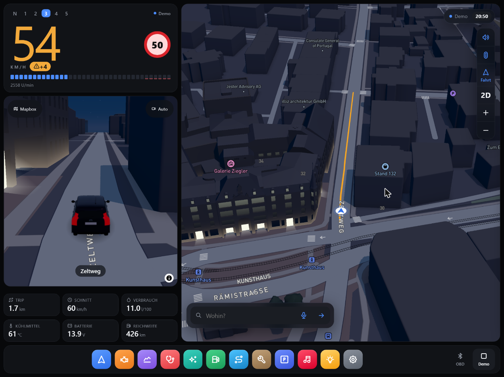
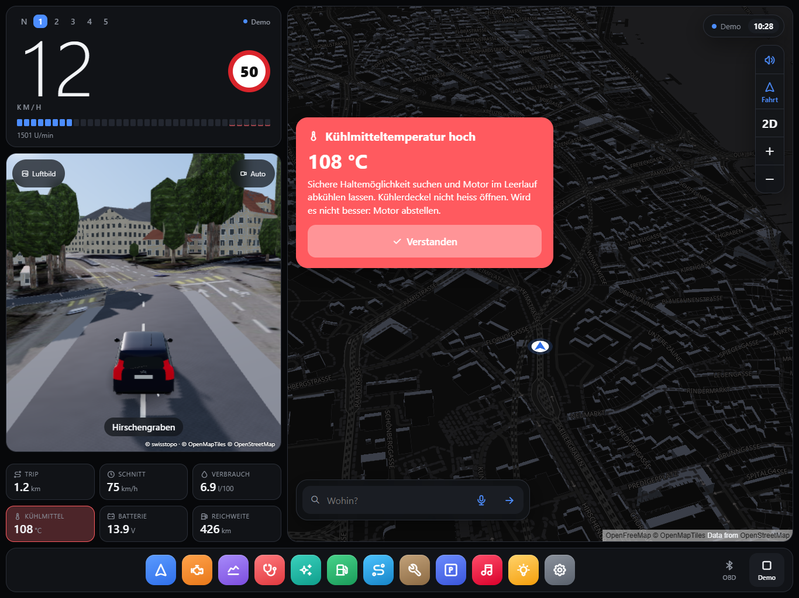
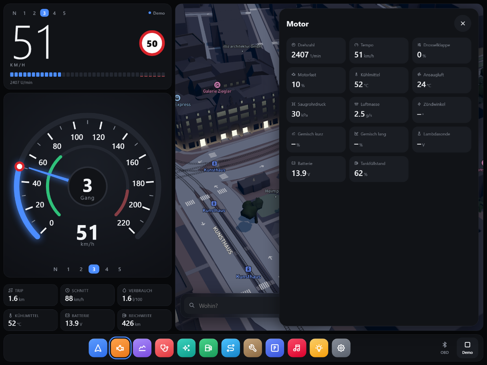
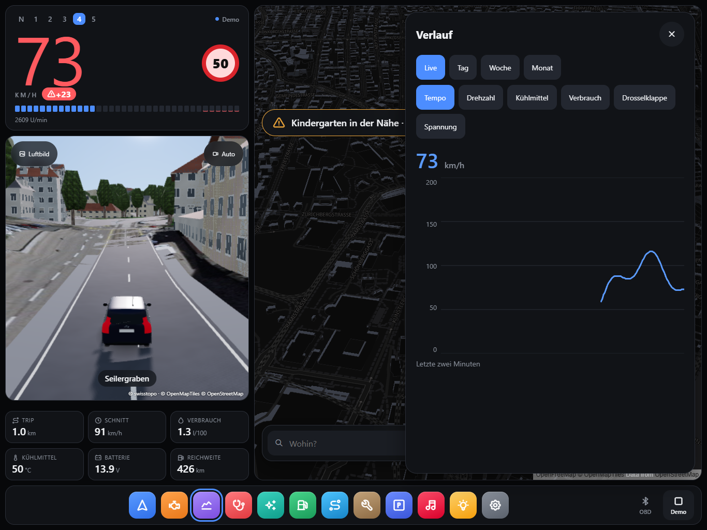
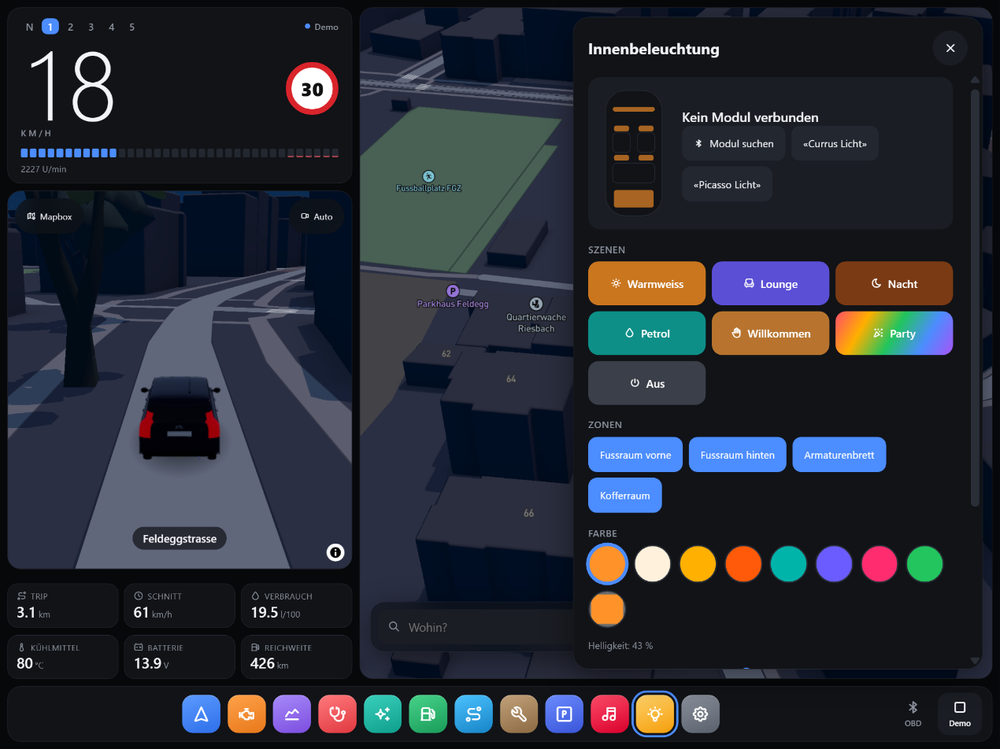
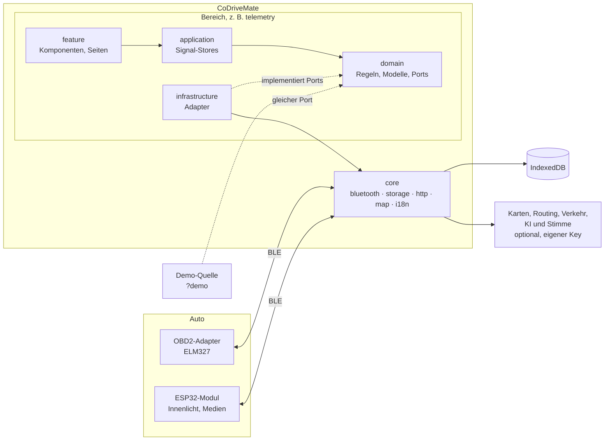

# CoDriveMate

**Ein Tablet wird zum smarten Cockpit für ältere Autos.** Ein Bluetooth-Adapter
am OBD2-Stecker liefert die Motordaten, die App zeigt Tempo, Drehzahl, Verbrauch,
Reichweite und Warnungen. Dazu kommen Navigation mit Live-Verkehr, eine 3D-Ansicht
des Autos in seiner echten Umgebung, Diagnose, Fahrtenbuch, Wartung, ein
KI-Copilot mit Sprache und die Steuerung der Innenbeleuchtung über ein
ESP32-Modul.

Erstes Fahrzeug ist ein Citroën Xsara Picasso von 2005. Die App ist aber für
jedes Fahrzeug mit OBD2 gebaut: Alles Fahrzeugspezifische steckt in einem
`VehicleProfile`.



> **Stand:** Alle Bilder stammen aus der Demo-Fahrt im Browser. Die App ist noch
> nicht im echten Auto und nicht am echten Adapter getestet. Was pro Bereich
> gebaut und was ungetestet ist, steht in der
> [Funktionsübersicht](docs/produkt/funktionsuebersicht.md).

## Was die App kann

| Bereich | Inhalt |
|---|---|
| Cockpit | Tempo, Gang, Tempolimit, Trip, Verbrauch, Kühlmittel, Batterie, Reichweite |
| OBD2 | ELM327 über Bluetooth LE, automatisch verbinden und wiederverbinden, Assistent mit Verbindungstest |
| Warnungen | Kühlmittel, Ladespannung, Reichweite, Motorkontrollleuchte: als Karte und als Ansage |
| Diagnose | Fehlercodes lesen und im Stand löschen, nur lesender Zugriff auf das Fahrzeug |
| Navigation | Suche, Route, Führung mit Ansagen, Live-Verkehr, Karte und Route auch ohne Netz |
| 3D-Ansicht | three.js-Modell des Autos in Gelände, Gebäuden und Bäumen von swisstopo |
| KI-Copilot | Fragen zum Auto mit Live-Daten, Sprache, Unterhaltungsmodus für die Fahrt |
| Fahrtenbuch | Fahrten automatisch aufzeichnen, Eco-Punkte, Auswertung nach Tag, Woche, Monat |
| Innenlicht | Szenen, Zonen, Farben und Effekte über ein ESP32-Modul, gedimmt beim Fahren |
| Weiteres | Wartung, Tank und Tankstellen, Parkplatz mit Parkuhr, Musik, Gerätetest |

| | |
|---|---|
|  |  |
| Fahrzeugwarnung (`?demo&fault=cool`) | Motorwerte live |
|  |  |
| Verlauf | Innenbeleuchtung |

## Technik

- **Angular 22**: Standalone-Komponenten, Signals, zoneless, eigene Oberfläche
  ohne UI-Bibliothek
- **Capacitor 8**: iOS und Android aus derselben Codebasis, der Browser bleibt
  ein vollwertiges Ziel (Web Bluetooth)
- **Bluetooth LE** über eine gemeinsame Schicht für OBD-Adapter und Lichtmodul
- **IndexedDB** für alle Daten und Caches, kein Backend, kein Tracking
- **MapLibre, Mapbox GL und three.js**, lokal gebündelt, damit die App auch ohne
  Netz läuft
- **Vier eigene Capacitor-Plugins** (Swift, Kotlin) in `plugins/`: natives
  Mapbox-SDK, Mediensteuerung, OBD über WLAN und MFi, Sprachausgabe
- **ESP32-Firmware** in `firmware/` für die Mediensteuerung
- **603 Unit-Tests** in 77 Dateien (Vitest), Architekturgrenzen per ESLint geprüft

## Architektur

Die App ist modular nach Fachbereichen aufgebaut. Jeder der 14 Bereiche unter
`src/app/domains/` hat dieselben vier Schichten. Hardware und Netz liegen immer
hinter einem Port, deshalb läuft die Demo-Fahrt durch denselben Code wie später
der echte Adapter.



| Schicht | Inhalt | Darf importieren |
|---|---|---|
| `domain/` | Modelle, reine Regeln, Ports | nur `shared/kernel`, kein Angular, kein Capacitor |
| `application/` | Signal-Stores, Anwendungsfälle | eigenes `domain/`, `core`, `shared` |
| `infrastructure/` | Adapter für BLE, HTTP, IndexedDB | eigenes `domain/`, `core`, `shared` |
| `feature/` | Komponenten, Seiten, Routen | eigenes `application/` und `domain/`, `shared/ui` |

Einige Entscheidungen dahinter:

- **Ohne Auto testbar.** Die Demo ist eine vollständige Datenquelle hinter dem
  Port des OBD-Adapters. Mit `fault=cool`, `volt`, `fuel` oder `mil` lassen sich
  die Warnungen auslösen.
- **Ohne Netz und ohne Key benutzbar.** Jeder externe Dienst ist freiwillig und
  hat einen Ersatz, siehe [Ausfallsicherung](docs/konzepte/ausfallsicherung.md).
- **Keine Keys im Code.** Der Benutzer trägt eigene Keys in den Einstellungen
  ein, sie bleiben auf dem Gerät.
- **OBD nur lesend.** Messwerte und Fehlercodes lesen, Fehlercodes nur auf
  ausdrücklichen Wunsch im Stand löschen. Kein Schreiben in Steuergeräte.
- **Keine Warnung vor Radar oder Kontrollen**, weder fest noch mobil.

Mehr dazu in [docs/](docs/README.md), zum Beispiel
[Architektur](docs/konzepte/architektur.md),
[Bluetooth](docs/konzepte/bluetooth.md) und
[Datenhaltung](docs/konzepte/datenhaltung.md).

## Starten

Voraussetzung: Node 22 oder neuer. Ein Paket kommt aus einer privaten Registry,
dafür braucht es ein Token.

```bash
cp .npmrc.example .npmrc   # NPM_TOKEN setzen
npm ci
npm start                  # http://localhost:4200
```

Die Demo-Fahrt startet mit `http://localhost:4200/?demo`, eine Warnung mit
`http://localhost:4200/?demo&fault=cool`.

```bash
npm run build      # Produktions-Build nach dist/app/browser
npm test           # Unit-Tests (Vitest)
npm run lint       # ESLint mit Architekturgrenzen
npm run cap:sync   # Build in die nativen Projekte android/ und ios/ kopieren
```

Für Android braucht es JDK 21, für iOS macOS mit Xcode oder Capawesome Cloud.
Bundle-ID: `app.codrivemate.ch`. Details zum Release stehen in der
[Release-Pipeline](docs/betrieb/release-pipeline.md).

## Weiteres

Regeln für die Arbeit am Code: [CLAUDE.md](CLAUDE.md) ·
Dokumentation: [docs/](docs/README.md)
