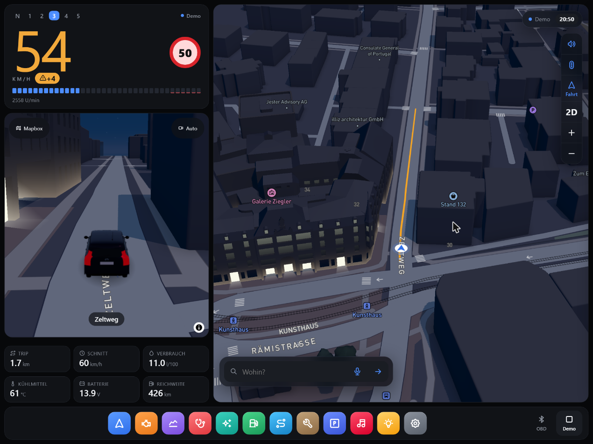
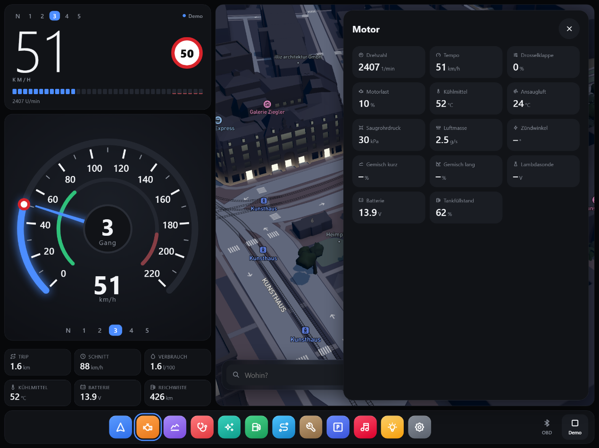
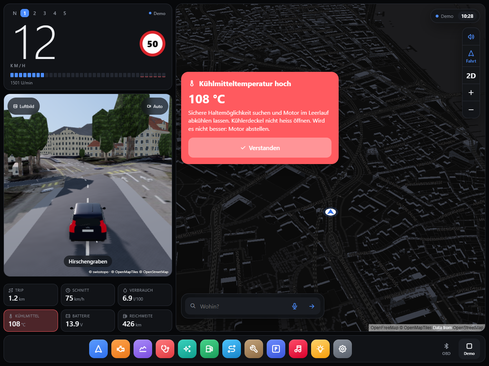
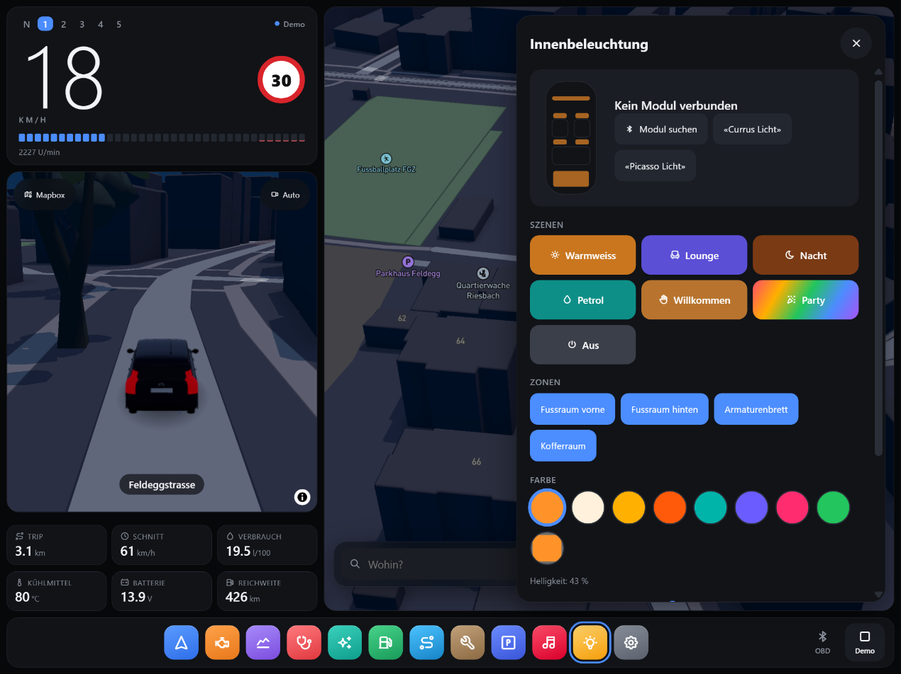

# CoDriveMate – Smart Cockpit für ältere Autos

**Ein Tablet, ein Bluetooth-Stecker, und das Auto von 2004 fährt wie eines von heute.**

CoDriveMate macht aus einem iPad ein Cockpit für Autos ohne modernes Infotainment. Ein
Bluetooth-LE-Adapter am OBD2-Anschluss liefert die Motordaten. Die App zeigt Tempo,
Drehzahl, Verbrauch, Reichweite und Warnungen und bringt Navigation mit Live-Verkehr,
eine 3D-Ansicht des Autos in seiner echten Umgebung, Diagnose, Fahrtenbuch, Wartung, die
Steuerung des LED-Innenlichts und einen KI-Beifahrer mit Sprache. Das erste Fahrzeug ist
ein Citroën Xsara Picasso, gebaut ist die App für jedes Fahrzeug.

---

## Was die App kann

| Bereich | Kurz |
|---|---|
| **Cockpit** | Tempo, Gang, Tempolimit, Verbrauch, Kühlmittel, Batterie, Reichweite; Kacheln färben sich bei Warnungen |
| **OBD2 über Bluetooth** | ELM327-Protokoll, serielle Befehle, adaptives Polling, automatisch neu verbinden mit Backoff |
| **Diagnose** | Fehlercodes lesen und im Stand löschen; die KI erklärt typische Ursachen für das Modell |
| **Navigation** | Suche mit Sprache, Route mit Live-Verkehr, Ansagen, Wetter entlang der Route, Karten und Routen offline, Route ohne Netz auf dem Gerät gerechnet |
| **3D-Ansicht** | three.js-Auto in der echten Umgebung: Gelände, Gebäude und Bäume von swisstopo, Himmel nach Tageszeit, Schatten |
| **Fahrtenbuch** | zeichnet automatisch auf, Eco-Score, Monate und Summen, CSV-Export, geplante Fahrten |
| **Wartung** | Service-Intervalle, MFK, Vignette, Kilometer zählen über OBD mit |
| **Tank** | Füllstand, Reichweite, Kosten, Tankstellen in der Nähe und auf der Route |
| **Parkplatz** | merken, Rückweg, Parkuhr mit Erinnerung, QR-Code fürs Handy |
| **Innenlicht** | ESP32-Modul über Bluetooth, Szenen, dimmt automatisch beim Losfahren |
| **KI-Copilot** | Fragen mit Live-Fahrzeugdaten, handelt mit Werkzeugen (Ziel setzen, Tankstellen, Licht, Parkplatz, Fahrt planen) |
| **Unterhaltung** | Begleiter, Fahrtipps, Eco-Coach, Plaudern, Fakten zu Orten an der Strecke (Wikipedia), Quiz |

## Highlight: Geplante Fahrten mit Thema

**Ein Beifahrer, der weiss, wohin die Fahrt geht und warum.**

Eine Navigation kennt nur Koordinaten. Ein guter Beifahrer weiss auch, *warum* man
unterwegs ist. Wer am Samstag ins Hallenbad fährt, soll am Morgen daran erinnert werden.
Unterwegs passt eine Bemerkung dazu, und bei der Ankunft heisst es: «Viel Spass beim
Schwimmen!»

- **Für später speichern:** Bei jedem Suchresultat tippt man auf den Kalender und gibt ein
  Thema, eine Beschreibung, auf Wunsch einen Tag ein und kann das Ziel als Favorit
  markieren.
- **Per Sprache:** «Merk dir das Hallenbad Oerlikon für Samstag, Schwimmen.» Der Copilot
  sucht den Ort, fragt kurz nach und speichert erst nach einem Ja.
- **Der Beifahrer weiss Bescheid:**
  - Er bietet die Fahrt am geplanten Tag zu Fahrtbeginn an.
  - Unterwegs geht er aufs Thema ein und gibt die Notiz als Erinnerung weiter.
  - Bei der Ankunft wünscht er etwas Passendes.
- **Ohne KI-Key** spricht er feste Sätze, die Funktion bleibt nutzbar.

## Wie es gebaut ist

- **Eine Codebasis für drei Plattformen:** Angular 22 (Standalone, Signals, Zoneless) mit
  Capacitor 8 für iPad, Android und Web. Builds und Releases laufen über Capawesome Cloud.
- **Domain-driven:** 14 Bereiche (Telemetrie, Navigation, Copilot, Fahrtenbuch …), jeder
  in den Schichten `domain`, `application`, `infrastructure` und `feature`. Die
  Fachregeln sind reines TypeScript ohne Framework. ESLint erzwingt die Grenzen
  zwischen den Bereichen.
- **Ports und Adapter:** Bluetooth, Netz, Speicher und Sensoren sitzen hinter
  Schnittstellen. Der Demo-Modus ist eine vollwertige Datenquelle hinter demselben Port
  wie der echte OBD-Adapter, inklusive Fehlerszenarien (Überhitzung, schwache Batterie,
  leerer Tank). So ist alles ohne Auto testbar.
- **Ausfallsicher:** Jeder externe Dienst ist optional und hat einen Ersatz
  (Provider-Kette: Mapbox, OpenStreetMap, offline auf dem Gerät). Die App bleibt ohne
  Netz und ohne einen einzigen API-Key nutzbar.
- **KI mit Werkzeugen:** Claude oder OpenAI über Tool-Calls. Alles, was der Fahrer nicht
  ausdrücklich verlangt hat, braucht ein gesprochenes oder angetipptes Ja.
- **Performance auf dem Tablet:** Die 3D-Szene pausiert im Hintergrund, Pixel-Ratio ist
  begrenzt, Ressourcen werden sauber freigegeben. Auf schwachen Geräten fällt die App
  auf die 2D-Karte zurück.
- **Qualität:** Rund 650 Unit- und Komponententests (Vitest), Lint mit
  Architekturregeln, Build als Pflicht vor jedem Merge.

## Sicherheit und Datenschutz

- **Fahren geht vor:** Die Bedienung ist sprachbasiert, mit grossen Touch-Flächen und
  Werten, die man mit einem Blick erfasst. Der Beifahrer schweigt vor jedem Abbiegen und
  bei Warnungen. Navigationsansagen unterbrechen alles.
- **OBD nur lesend:** Die App schreibt nie in ein Steuergerät.
- **Kein Backend, kein Tracking:** Fahrten, Positionen und Einstellungen bleiben in
  IndexedDB auf dem Gerät.
- **Nur mit eigenem Key:** An die KI geht nur, was dafür nötig ist, und nur mit dem eigenen
  Key des Nutzers. Koordinaten oder Strecken gehen nie mit.
- **Schweizer Recht eingehalten:** Es gibt keine Blitzer- oder Kontrollwarnungen,
  weder in Gefahrenhinweisen noch in Verkehrsmeldungen noch in KI-Antworten.
- **Lizenzen eingehalten:** Google-Daten erscheinen nur auf der Google-Karte. Daten von
  Mapbox und Google werden nicht gespeichert.

**Stack:** Angular 22 · TypeScript · Capacitor 8 · three.js · MapLibre / Mapbox ·
OpenStreetMap / swisstopo · Bluetooth LE / ELM327 · ESP32 · IndexedDB · Vitest ·
Claude / OpenAI Tool-Use · Web Speech · Capawesome Cloud
